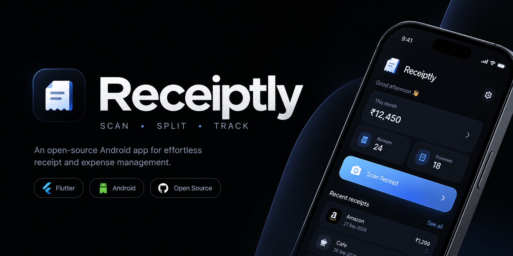

<p align="center">
  
</p>

<h1 align="center">Receiptly</h1>

<p align="center"><strong>Snap a receipt. We'll sort out the numbers.</strong></p>

<p align="center">
  Mobile-first receipt scanning with honest OCR review.<br />
  Capture, verify, save — history stays searchable on your device.
</p>

<p align="center">
  
  
  
  
  
  
</p>



> **Product principle:** OCR does the tedious work; you stay in control. OCR is never presented as infallible — verification and correction are fast by design.

No backend. No database server. No API keys embedded. Your receipts live in your browser.

---

## Why Receiptly?

Paper receipts are annoying. Typing line items is worse. Receiptly sits in the middle:

1. **You snap** — camera, drag & drop, file picker, or paste.
2. **It reads** — image cleanup + Puter OCR (Mistral, Textract fallback) → structured merchant, date, items, totals.
3. **You verify** — side-by-side review, low-confidence flags, one-tap fixes. Totals never get silently overwritten.
4. **You keep** — searchable history, bill splitting, JSON export. Delete anytime with undo.

If OCR fails, you're never stuck: retry, upload another photo, or enter it manually on the same data model.

## ✨ Features

| Scan & Upload | OCR & Extraction |
|---|---|
| 📷 Camera, photo library, file picker | 🔍 `validate → preprocess → OCR → parse → validate` pipeline |
| 🖱️ Drag & drop + clipboard paste (desktop) | 🤖 Puter OCR via `puter.js` — user-pays, no key in code |
| ✅ MIME / extension / size / content validation | 🧾 Merchant, date, currency, items, subtotal, tax, tip, total |
| 🖼️ Preview, replace, remove | 🚩 Confidence flags + honest staged progress, no fake % |

| Review editor (the core screen) | History & extras |
|---|---|
| 🖥️ Two-pane desktop, stacked mobile | 🔎 Search by merchant, item, date, amount |
| ✏️ Add / edit / duplicate / delete / reorder items | ↕️ Sort newest / oldest / highest / lowest |
| 🧮 Auto-recalc with locked-total protection | 🗑️ Delete with confirm + 8s undo |
| 🔎 Zoom / pan / fullscreen + copy summary | ➗ Bill splitter with multi-currency + share message |

**Polish included:** dark mode (follows OS, persisted), toasts, skeletons, empty/error/loading states, keyboard shortcuts (`N` scan, `/` search, `B` split, `Ctrl/Cmd+S` save, `?` help, `Esc` close), skip-link + ARIA + reduced-motion support.

## 🚀 Quick start

Prerequisites: Node.js 18+

```bash
npm install
npm run dev      # http://localhost:5173
```

```bash
npm run build    # tsc --noEmit + vite build → dist/
npm run preview  # preview production build
npm run test     # vitest run
npm run test:watch
```

First scan will prompt Puter sign-in — OCR compute is billed to your Puter account, not to this app.

## 🧭 How it works

```
Open App → Scan / Upload → Preprocess → OCR (Puter) →
Parse → Review & correct → Save → Searchable history
```

Data model (conceptual):

```
Receipt
├── merchant, date, currency
├── items[] (name, quantity, unit_price, total_price, confidence)
├── subtotal, discount, tax, tip, total (totalLocked protects manual edits)
├── ocrRawText, ocrMeanConfidence, needsReview[]
└── imageId (IndexedDB) + thumbnail (list rendering)
```

Single abstraction lives in `src/lib/ocr/index.ts` — UI code never touches Puter directly, so the provider can be swapped later.

## 🛠️ Tech stack

| Layer | Choice |
|---|---|
| UI | React 18, Vite 5, plain CSS design system (`src/index.css`) |
| OCR | `@heyputer/puter.js` (Mistral / Textract), `tesseract.js` (chunked fallback path) |
| Storage | `localStorage` (receipts) + IndexedDB (photos) — single-device |
| Validation | Guards in `lib/validation.ts`, `security.ts`, `ocr/validator.ts` |
| Tests | Vitest (`receipt.test.ts`, `split.test.ts`, `receipt-puter.test.ts`) |

## 📁 Project structure

```
src/
├── App.tsx              # views: home / scan / review / receipts / settings / split
├── types.ts             # Receipt, ReceiptItem, View, Toast
├── hooks.ts             # useTheme, useToasts
├── components/
│   ├── scan.tsx         # Uploader, ProcessingView, OcrError
│   ├── review.tsx       # ReceiptEditor (two-pane / mobile)
│   ├── history.tsx      # ReceiptsScreen (search / sort / filter)
│   ├── screens.tsx      # HomeScreen, SettingsScreen
│   ├── split.tsx        # Bill splitter UI
│   ├── chrome.tsx       # Header, TabBar, Modal, Toasts, Shortcuts
│   └── icons.tsx
└── lib/
    ├── ocr/             # index.ts (pipeline), puter.ts, parser.ts, validator.ts
    ├── bill-splitter/   # calculateSplit, currencies, paymentMessage
    ├── images.ts        # preprocessing, thumbnails
    ├── parser.ts        # draftFromStructured, blankReceipt
    ├── store.ts / db.ts # localStorage + IndexedDB
    ├── format.ts        # money / currency
    └── security.ts      # upload checks, randomized filenames
```

## 🔒 Privacy & security

- Receipt images are sensitive: randomized storage keys, private by default, no guessable URLs, max-size + MIME validation, never trust filenames.
- Images are sent to the Puter OCR service for reading only. Deleting a receipt removes it (and its photo) from this browser.
- No secrets in client code. Production hosting should enforce HTTPS + secure headers.
- Settings → Export gives you `receipts-backup.json` for backup/migration. Clear-all wipes everything locally.

## 🌐 Browser support

Current Chrome, Safari, Edge, Firefox. Watch Mobile Safari camera / file-input / clipboard quirks.

## 🗺️ Roadmap

Next up: HEIC support where feasible, bounding-box highlights, amount-range + currency filters, PWA offline shell.

Explicitly out of scope: accounting suites, banking / crypto integrations, chatbots, analytics dashboards.

---

<p align="center">
  <br />
  <sub>OCR does the tedious work. You stay in control.</sub>
</p>

Private project — no license granted. If you were given access, keep credentials and receipt data to yourself.
